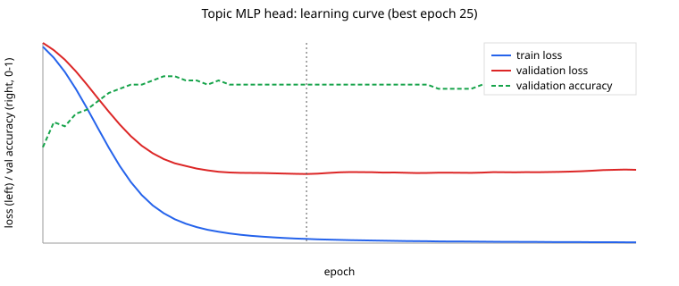

# Topic Head Training

Generated by `eval/train-topic-head.ts` on 2026-10-31 (seed 42).

- Encoder: frozen `all-MiniLM-L6-v2` (384-d sentence embeddings)
- Train / validation: 192 / 48 examples (stratified 80/20 split of eval/train.json)
- Test: 160 held-out headlines from eval/benchmark.json (never used for training or model selection)
- MLP: Linear(384,64) → ReLU → Dropout(0.2) → Linear(64,8) → softmax; Adam lr 0.003, batch 32, L2 0.0001, early stopping on validation loss (patience 30)
- Best epoch: linear 400, MLP 25; total training time 6.1 s on CPU
- Shipped-inference check: 0 prediction mismatches between trainer and lib/topic-head.ts

| Method (test set) | Accuracy | Macro-F1 |
|---|---|---|
| Neural zero-shot (prototypes, no training) | 86.3% | 0.866 |
| Softmax regression head (trained) | 88.1% | 0.880 |
| MLP head 384-64-8 (trained) | 90.6% | 0.905 |
| Hybrid: keyword (strength >= 2) else MLP head | 88.8% | 0.887 |

Caveat: train and test headlines were both hand-written for this project, so absolute numbers are optimistic relative to live feeds; the comparison between methods is the meaningful part. Run with `--from-db` after ingesting real stories to add pseudo-labelled live data.
